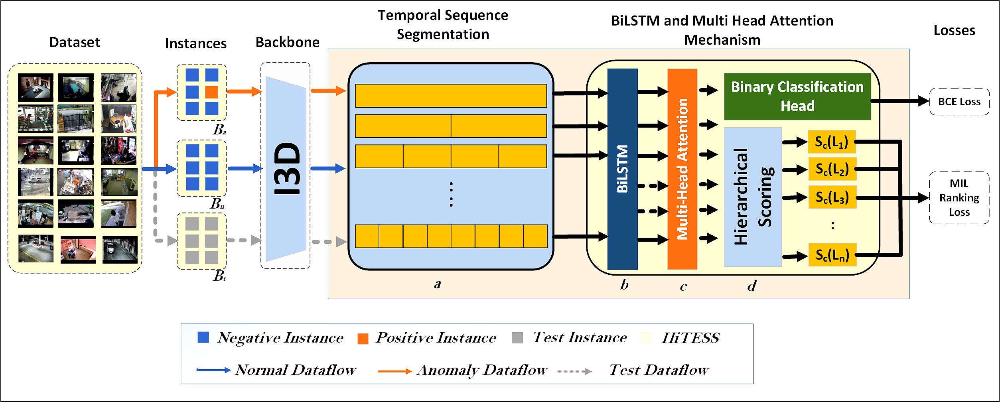

# HiTeSS_VAD
The code of Hierarchical Sequence Selection for Video Anomaly Detection with Weak Labels
## Overview

HiTESS is a weakly supervised video anomaly detection framework designed to address multi-scale temporal dependencies while improving fine-grained temporal anomaly localization.

The framework introduces:

* **Hierarchical Temporal Segmentation** for capturing anomalies at multiple temporal resolutions.
* **Bidirectional Long Short-Term Memory (BiLSTM)** for modeling forward and backward temporal dependencies.
* **Multi-Head Attention (MHA)** for capturing long-range temporal relationships and emphasizing salient features.
* **Hierarchical Scoring Strategy** for aggregating segment-level and sequence-level anomaly predictions.
* **Multiple Instance Learning (MIL) Ranking Loss** for training using only video-level labels.

The model achieves superior performance on the UCF-Crime and XD-Violence benchmarks, improving AUC by **1.32%** and AP by **4.8%**, respectively, over the reported comparison methods.

---

## Framework

<p align="center">
  
</p>

The proposed framework consists of:

1. I3D-Based Spatio-Temporal Feature Extraction
2. Hierarchical Temporal Segmentation
3. Bidirectional Long Short-Term Memory (BiLSTM)
4. Multi-Head Attention (MHA)
5. Hierarchical Scoring Strategy
6. Multiple Instance Learning (MIL) Ranking Loss
7. Anomaly Detection and Temporal Localization

---

## Key Contributions

* A hierarchical temporal sequence segmentation framework for detecting anomalies across multiple temporal resolutions.
* Integration of BiLSTM and Multi-Head Attention for capturing bidirectional temporal dependencies and long-range contextual relationships.
* Hierarchical scoring strategy that aggregates local segment-level and global sequence-level anomaly predictions.
* MIL-based ranking optimization for learning discriminative anomaly representations using only video-level labels.
* Fine-grained temporal anomaly localization with improved detection accuracy and reduced false positives.

---

## Performance

### UCF-Crime

| Method                | Feature     | AUC (%)   |
| --------------------- | ----------- | --------- |
| MIST                  | I3D-RGB     | 82.30     |
| RTFM                  | I3D-RGB     | 84.03     |
| BN-WVAD               | I3D-RGB     | 84.29     |
| MSL                   | I3D-RGB     | 85.30     |
| NG-MIL                | I3D-RGB     | 85.63     |
| GLFE                  | I3D-RGB     | 86.12     |
| MGFN                  | I3D-RGB     | 86.98     |
| **HiTESS (Ours)**     | I3D-RGB     | **88.30** |

---

### XD-Violence

| Method                | Feature     | AP (%)    |
| --------------------- | ----------- | --------- |
| Wu et al.             | I3D-RGB     | 78.64     |
| RTFM                  | I3D-RGB     | 77.81     |
| MSL                   | I3D-RGB     | 78.28     |
| NG-MIL                | I3D-RGB     | 78.51     |
| CRFD                  | I3D-RGB     | 75.90     |
| MGFN                  | I3D-RGB     | 79.19     |
| ST-HTAM               | Transformer | 78.06     |
| **HiTESS (Ours)**     | I3D-RGB     | **84.91** |

---

## Datasets
The following datasets were used and extracted using the I3D pre-trained network
* UCF Crime Dataset (https://www.crcv.ucf.edu/projects/real-world/)
* XD Violence Dataset (https://roc-ng.github.io/XD-Violence/)
## I3D Weights (https://github.com/dlpbc/keras-kinetics-i3d/releases)
* **WEIGHTS_PATH:**
  * rgb_kinetics_only_weights
  * flow_kinetics_only_weights
  * rgb_imagenet_and_kinetics_weights
  * flow_imagenet_and_kinetics_weights
* **WEIGHTS_PATH_NO_TOP:**
  * rgb_kinetics_only_weights_no_top
  * flow_kinetics_only_weights_no_top
  * rgb_imagenet_and_kinetics_weights_no_top
  * flow_imagenet_and_kinetics_weights_no_top


## I3D Features
* i3d_net.py
* dataset_utility.py
* process_dataset.py

## Citation

```bibtex

@article{abiew2026hierarchical,
  title={Hierarchical temporal sequence segmentation for weakly supervised video anomaly detection},
  author={Abiew, Nuku Atta Kordzo and Gao, Lijian and Mao, Qirong},
  journal={Expert Systems with Applications},
  volume={295},
  pages={128753},
  year={2026},
  doi={10.1016/j.eswa.2025.128753}
  publisher={Elsevier}
}
```
---

## Acknowledgement

This work was conducted at:

* School of Computer Science and Communication Engineering, Jiangsu University, Zhenjiang, Jiangsu, China
* Faculty of Computing and Information Systems, Ghana Communication Technology University, Accra, Ghana

---

## Status

🚀 Paper Published in Expert Systems with Applications (ESWA), Volume 295 (2026), Article 128753.

📄 DOI: https://doi.org/10.1016/j.eswa.2025.128753

---
## TODO
💻 Source code and pretrained models will be released soon.
